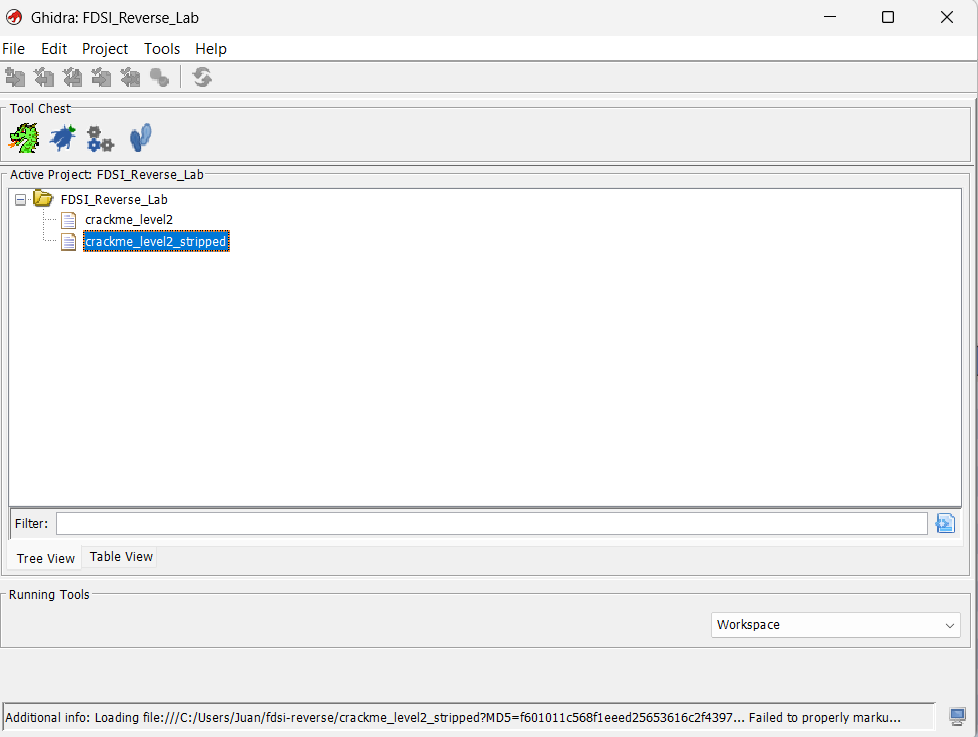
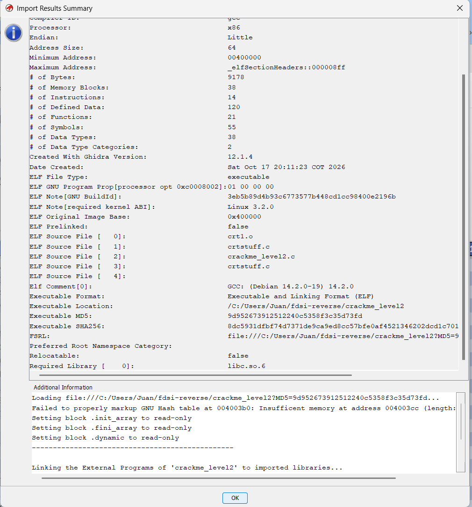
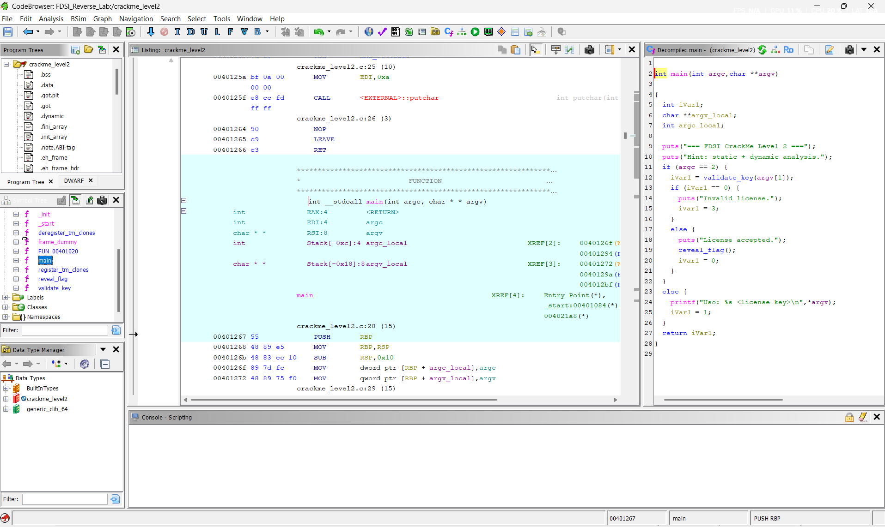
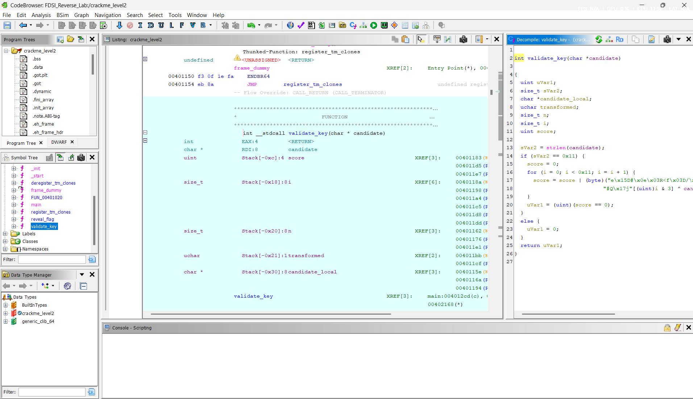
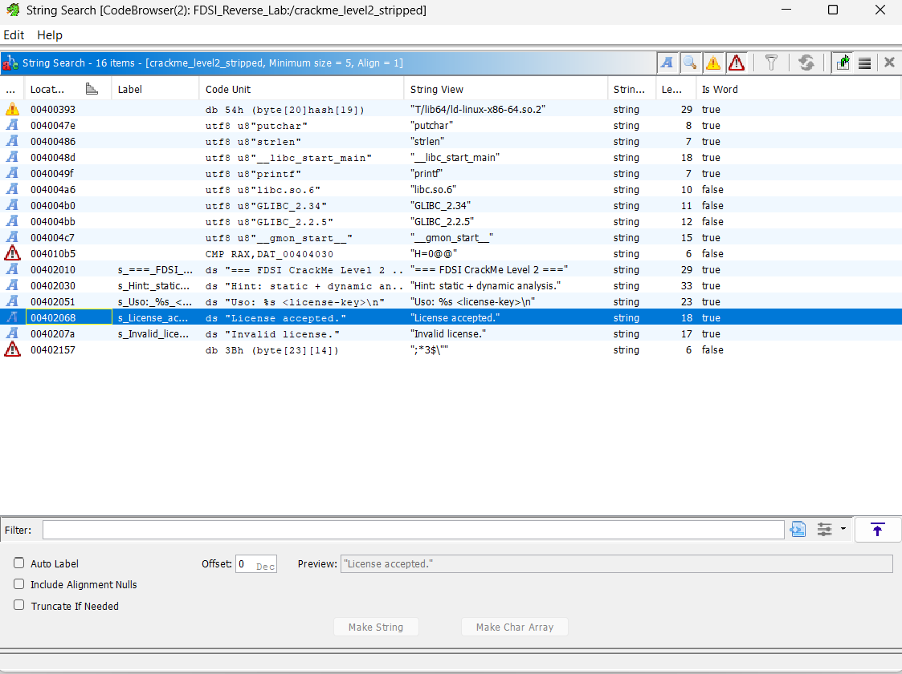
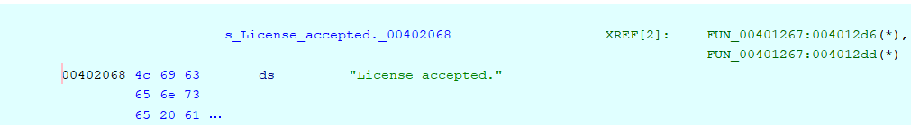
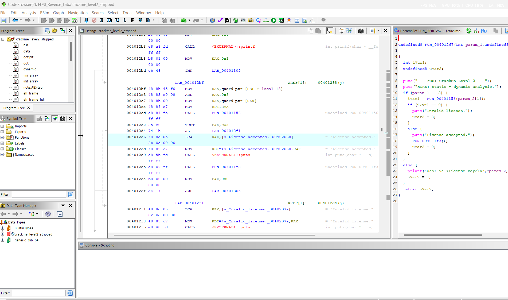

# Nivel 2 — Ghidra: reconstruir la validación

> Binario: `crackme_level2` · SHA-256 `8dc5931dfbf74d7371de9ca9ed8cc57bfe0af4521346202dcd1c701dd8b6f4e5` (verificado: OK)
> Entorno: análisis estático con Ghidra (Windows) + objdump; confirmación dinámica con GDB en VM Ubuntu `lab3-server`.

## 1. Observación inicial

```text
$ ./crackme_level2
=== FDSI CrackMe Level 2 ===
Hint: static + dynamic analysis.
Uso: ./crackme_level2 <license-key>

$ ./crackme_level2 AAAA
=== FDSI CrackMe Level 2 ===
Hint: static + dynamic analysis.
Invalid license.
```

`strings -n 5 crackme_level2` (fragmento):

```text
putchar
strlen
printf
q{vpLP_^H
SEVhG[BDH
[BDhPSUJH
License accepted.
Invalid license.
validate_key
expected
```

- A diferencia del Nivel 1, **no aparece ninguna cadena candidata** a clave y ya no se importa `strcmp`: la comparación se hace a mano, byte a byte.
- Se importa `strlen` → probablemente hay un control de longitud.
- La info de debug revela los nombres `validate_key`, `expected`, `transformed`, `candidate`, `score` y `reveal_flag`.
- `q{vpLP_^H`, `SEVhG[BDH`… son de nuevo constantes `movabs` de una FLAG ofuscada (dentro de `reveal_flag`).

> Salidas generadas en la VM: [ejecución, strings y resultado](vm-evidence/level2_run.txt) · [validate_key (objdump)](vm-evidence/level2_validate.txt) · [.rodata](vm-evidence/level2_rodata.txt) · [Boss](vm-evidence/boss.txt)

## 2. Proceso en Ghidra

1. Proyecto **Non-Shared** creado: `FDSI_Reverse_Lab` (Ghidra 12.1.4 PUBLIC, directorio `C:\Users\Juan\fdsi-reverse`) con `crackme_level2` y `crackme_level2_stripped`.

   

2. Importado `crackme_level2`, análisis automático aceptado. El resumen de importación confirma el mismo SHA-256 (`8dc5931d…`), x86 64 bits little-endian, base `0x400000`, no reubicable y 55 símbolos.

   

3. `main` (`0x401267`) → llama a `validate_key(argv[1])`; si devuelve ≠ 0 imprime `License accepted.` y llama a `reveal_flag()`.

   Decompilado de `main` en Ghidra (resumido; en la captura la variable aparece como `iVar1`, aquí renombrada a `result`):

   ```c
   int main(int argc, char **argv) {
       puts("=== FDSI CrackMe Level 2 ===");
       puts("Hint: static + dynamic analysis.");
       if (argc == 2) {
           result = validate_key(argv[1]);
           if (result == 0) { puts("Invalid license.");  result = 3; }
           else             { puts("License accepted."); reveal_flag(); result = 0; }
       } else {
           printf("Uso: %s <license-key>\n", *argv);
           result = 1;
       }
       return result;
   }
   ```

   Códigos de salida: `0` = licencia válida, `1` = uso incorrecto, `3` = licencia inválida (coincide con `exited with code 03` observado en GDB).
4. Función de validación: `validate_key` en `0x401156`.



Para llegar a la validación se siguió la llamada desde `main` (doble clic en `validate_key` en la línea `iVar1 = validate_key(argv[1]);`).



> La captura muestra el decompilado tal como lo genera Ghidra (`sVar2`, `uVar1`); el pseudocódigo siguiente aplica los renombres de la tabla.

### Decompilado de `validate_key` en Ghidra

Como `crackme_level2` conserva DWARF, Ghidra recupera los nombres originales de la mayoría de variables (`candidate`, `score`, `i`, `n`, `transformed`). Ghidra simplificó `n` (constante `0x11`) y `transformed` dentro de la expresión, y mostró los arreglos `expected` y `k` como literales de cadena por ser bytes de `.rodata`:

```c
int validate_key(char *candidate) {
    input_len = strlen(candidate);                 // sVar2 → input_len
    if (input_len == 0x11) {
        score = 0;
        for (i = 0; i < 0x11; i = i + 1) {
            score = score | (byte)("e\x15D#\x0e\x03R<f\x03D/\x0ec'X\x15"[i]   // expected
                                  ^ ("#Q\x17j"[(uint)i & 3] ^ candidate[i])); // k[i % 4]
        }
        is_valid = (uint)(score == 0);             // uVar1 → is_valid
    } else {
        is_valid = 0;
    }
    return is_valid;
}
```

### Renombres aplicados

| Nombre en Ghidra | Nombre asignado | Justificación |
|---|---|---|
| `sVar2` | `input_len` | Recibe el retorno de `strlen(candidate)` y se compara con `0x11`. |
| `uVar1` | `is_valid` | Vale `(score == 0)` o `0` si la longitud falla; es el valor de retorno. |
| `"#Q\x17j"` (`0x40208b`) | `k` | Arreglo de 4 bytes (`23 51 17 6a`) indexado con `i & 3`. |
| `"e\x15D#…"` (`0x402090`) | `expected` | Arreglo de 17 bytes con el que se compara el byte transformado. |

Correspondencia con el stack (útil para el binario stripped, donde no hay nombres): `candidate_local` = `[rbp-0x28]`, `n` = `[rbp-0x18]`, `i` = `[rbp-0x10]`, `transformed` = `[rbp-0x19]`, `score` = `[rbp-0x4]`.

## 3. Análisis del algoritmo (`objdump -d -M intel --disassemble=validate_key`)

```asm
40115e:  mov    QWORD PTR [rbp-0x28],rdi        ; candidate = argv[1]
401162:  mov    QWORD PTR [rbp-0x18],0x11       ; key_len = 17
401171:  call   strlen                          ; strlen(candidate)
401176:  cmp    QWORD PTR [rbp-0x18],rax
40117a:  je     401183                          ; si longitud == 17 continúa
40117c:  mov    eax,0x0                         ; si no → return 0
401183:  mov    DWORD PTR [rbp-0x4],0x0         ; score = 0
40118a:  mov    QWORD PTR [rbp-0x10],0x0        ; i = 0
; --- cuerpo del bucle ---
40119f:  movzx  eax,BYTE PTR [rax]             ; candidate[i]
4011a8:  and    eax,0x3                         ; i & 3  (== i % 4)
4011ae:  lea    rax,[rip+0xed6]                 ; &k  (0x40208b)
4011b5:  movzx  eax,BYTE PTR [rdx+rax*1]        ; k[i % 4]
4011b9:  xor    eax,ecx                         ; transformed = candidate[i] ^ k[i % 4]
4011be:  lea    rdx,[rip+0xecb]                 ; &expected (0x402090)
4011cf:  xor    al,BYTE PTR [rbp-0x19]          ; expected[i] ^ transformed  (0 si coinciden)
4011d5:  or     DWORD PTR [rbp-0x4],eax         ; score |= diferencia
4011d8:  add    QWORD PTR [rbp-0x10],0x1        ; i++
4011e1:  cmp    rax,QWORD PTR [rbp-0x18]
4011e5:  jb     401194                          ; mientras i < 17
; --- fin ---
4011e7:  cmp    DWORD PTR [rbp-0x4],0x0
4011eb:  sete   al                              ; return (score == 0)
```

- **Longitud esperada de la clave:** `17` (`mov [rbp-0x18],0x11` + `cmp` con el retorno de `strlen`).
- **Arreglo cíclico `k`:** 4 bytes en `0x40208b`, indexado con `i & 3` (equivalente a `i % 4`).
- **Arreglo `expected`:** 17 bytes en `0x402090` (`.rodata`).
- **Transformación por byte:** `XOR` con `k[i % 4]`.
- **Condición de éxito:** ningún byte difiere → `score == 0`. Al usar `OR` acumulado en vez de un `return` temprano, el bucle **siempre recorre los 17 bytes** (comparación de tiempo constante; GDB no puede ver en qué byte falla por el número de iteraciones).

### Contenido de `.rodata`

```bash
objdump -s -j .rodata crackme_level2
```

```text
 402080 64206c69 63656e73 652e0023 51176a00  d license..#Q.j.
 402090 65154423 0e03523c 6603442f 0e632758  e.D#..R<f.D/.c'X
 4020a0 15                                   .
```

```text
k        (0x40208b): 23 51 17 6a                                      ("#Q.j")
expected (0x402090): 65 15 44 23 0e 03 52 3c 66 03 44 2f 0e 63 27 58 15
```

`k` va justo después del `\0` de `"Invalid license."`, por eso `strings` no lo muestra como cadena independiente.

## 4. Pseudocódigo propio

```text
función validate_key(candidate):
    k        = [0x23, 0x51, 0x17, 0x6a]
    expected = [0x65, 0x15, 0x44, 0x23, 0x0e, 0x03, 0x52, 0x3c, 0x66,
                0x03, 0x44, 0x2f, 0x0e, 0x63, 0x27, 0x58, 0x15]

    si strlen(candidate) != 17: devolver 0

    score = 0
    para i desde 0 hasta 16:
        transformed = candidate[i] XOR k[i mod 4]
        score = score OR (expected[i] XOR transformed)   // 0 solo si son iguales
    devolver (score == 0)
```

## 5. Inversión de la transformación

XOR es su propia inversa: si `c ^ k = e`, entonces `c = e ^ k`. Por tanto cada carácter de la clave es:

```text
clave[i] = expected[i] XOR k[i mod 4]
```

Ejemplo: `expected[0] ^ k[0] = 0x65 ^ 0x23 = 0x46 = 'F'`, `expected[1] ^ k[1] = 0x15 ^ 0x51 = 0x44 = 'D'`.

```python
# solve_level2.py
k = [0x23, 0x51, 0x17, 0x6a]
expected = [0x65, 0x15, 0x44, 0x23, 0x0e, 0x03, 0x52, 0x3c, 0x66,
            0x03, 0x44, 0x2f, 0x0e, 0x63, 0x27, 0x58, 0x15]
print(''.join(chr(e ^ k[i % 4]) for i, e in enumerate(expected)))
```

**Clave reconstruida:** `FDSI-REVERSE-2026`

```bash
./crackme_level2 FDSI-REVERSE-2026
```

```text
=== FDSI CrackMe Level 2 ===
Hint: static + dynamic analysis.
License accepted.
FLAG{ghidra_plus_gdb}
```

**FLAG Nivel 2:** `FLAG{ghidra_plus_gdb}`

---


# Boss Level — `crackme_level2_stripped`

> SHA-256 `c8e638741272a87ee3b30fe8878898c1aa977e6a879a1ec0b271034b5bb9aed3` (verificado: OK)

## 1. Reconocimiento

```text
$ file crackme_level2_stripped
crackme_level2_stripped: ELF 64-bit LSB executable, x86-64, ..., dynamically linked, ..., stripped

$ nm crackme_level2_stripped
nm: crackme_level2_stripped: no symbols

$ nm -D crackme_level2_stripped
                 w __gmon_start__
                 U __libc_start_main@GLIBC_2.34
                 U printf@GLIBC_2.2.5
                 U putchar@GLIBC_2.2.5
                 U puts@GLIBC_2.2.5
                 U strlen@GLIBC_2.2.5
```

## 2. ¿Qué desapareció con `strip`?

| Información | `crackme_level2` | `crackme_level2_stripped` |
|---|---|---|
| `.symtab` / `.strtab` (símbolos locales: `main`, `validate_key`, `reveal_flag`, `k.1`, `expected.0`) | ✅ | ❌ |
| Secciones `.debug_*` (DWARF: nombres de variables `candidate`, `score`, tipos, nº de línea, ruta del `.c`) | ✅ | ❌ |
| Nº de secciones (`readelf -h`, *Number of section headers*) | 36 | 28 |
| Tamaño | 18 200 B | 14 424 B |
| `.dynsym` (imports de libc: `strlen`, `puts`, `putchar`, `printf`) | ✅ | ✅ (necesarios para enlazar en ejecución) |
| Cadenas de `.rodata` y arreglos `k` / `expected` | ✅ | ✅ |
| Código máquina (`.text`) | ✅ | ✅ **idéntico, mismas direcciones** |

`strip` elimina solo metadatos para humanos/depuradores; **la lógica y los datos siguen ahí**. Por eso la misma clave sigue funcionando y el análisis solo se vuelve más lento, no imposible. (Sin símbolos, objdump etiqueta las direcciones respecto al último símbolo conocido, p. ej. `<printf@plt+0xf6>`, lo que es engañoso.)

## 3. Cómo encontré de nuevo la validación

### 3.1 Desde el punto de entrada hasta `main`

```bash
objdump -d -M intel crackme_level2_stripped > evidence/boss_objdump.txt
grep -m1 -B2 -A14 "<.text>:" evidence/boss_objdump.txt
```

```asm
401070:  xor    ebp,ebp                 ; _start (entry point)
...
401084:  mov    rdi,0x401267            ; 1.er argumento de __libc_start_main = main
40108b:  call   QWORD PTR [rip+0x2f47]  ; __libc_start_main(main, argc, argv, ...)
401091:  hlt
```

`_start` siempre pasa la dirección de `main` en `rdi` a `__libc_start_main` → **`main` = `0x401267`**.

### 3.2 En `main`: referencias a las cadenas de resultado

```asm
4012cd:  call   401156                  ; FUN_00401156(argv[1])  → candidata a validación
4012d2:  test   eax,eax
4012d4:  je     4012f1                  ; 0 → fallo
4012d6:  lea    rax,[rip+0xd8b]         ; 0x402068 = "License accepted."
4012e0:  call   puts
4012e5:  call   4011f3                  ; FUN_004011f3 = reveal_flag
4012f1:  lea    rax,[rip+0xd82]         ; 0x40207a = "Invalid license."
4012fb:  call   puts
```

La función cuyo retorno decide entre `"License accepted."` y `"Invalid license."` es `FUN_00401156`; la que se llama solo en la rama de éxito (`FUN_004011f3`) es la que imprime la FLAG.

### 3.3 Confirmación por patrón de comportamiento

```bash
grep -n -E "call.*strlen|and +eax,0x3|xor +eax,ecx|sete" evidence/boss_objdump.txt
```

```text
119:  401171:   call   401050 <strlen@plt>   ; control de longitud
134:  4011a8:   and    eax,0x3               ; i % 4 → índice del arreglo cíclico
138:  4011b9:   xor    eax,ecx               ; transformación XOR
152:  4011eb:   sete   al                    ; return score == 0
```

Las cuatro instrucciones características del algoritmo aparecen dentro de `FUN_00401156` (`0x401156`–`0x4011f2`), en las **mismas direcciones** que `validate_key` del binario con símbolos.

### 3.4 Confirmación en Ghidra (referencias cruzadas)

1. *Search → For Strings…* lista 16 cadenas; `"License accepted."` está en `0x00402068` (`s_License_accepted._00402068`).



2. En el Listing, la cadena tiene `XREF[2]: FUN_00401267:004012d6(*), FUN_00401267:004012dd(*)` → la única función que usa el mensaje de éxito es `FUN_00401267`.



3. Decompilado de `FUN_00401267` (sin símbolos, Ghidra usa nombres genéricos):

```c
undefined8 FUN_00401267(int param_1, undefined8 *param_2) {
    puts("=== FDSI CrackMe Level 2 ===");
    puts("Hint: static + dynamic analysis.");
    if (param_1 == 2) {
        iVar1 = FUN_00401156(param_2[1]);
        if (iVar1 == 0) { puts("Invalid license.");  uVar2 = 3; }
        else            { puts("License accepted."); FUN_004011f3(); uVar2 = 0; }
    } else {
        printf("Uso: %s <license-key>\n", *param_2);
        uVar2 = 1;
    }
    return uVar2;
}
```



Por comportamiento: `param_1` = `argc`, `param_2` = `argv`, `FUN_00401267` = `main`, `FUN_00401156` = `validate_key` (su retorno decide el mensaje), `FUN_004011f3` = `reveal_flag` (solo se llama en la rama de éxito). La estructura es idéntica al `main` del binario con símbolos.

## 4. Resultado

```text
$ ./crackme_level2_stripped FDSI-REVERSE-2026
=== FDSI CrackMe Level 2 ===
Hint: static + dynamic analysis.
License accepted.
FLAG{ghidra_plus_gdb}
```

La misma clave funciona: el strip no cambió el algoritmo.

En GDB, sin símbolos, ya no existe `break validate_key`; se usa la dirección: `break *0x401156`.
